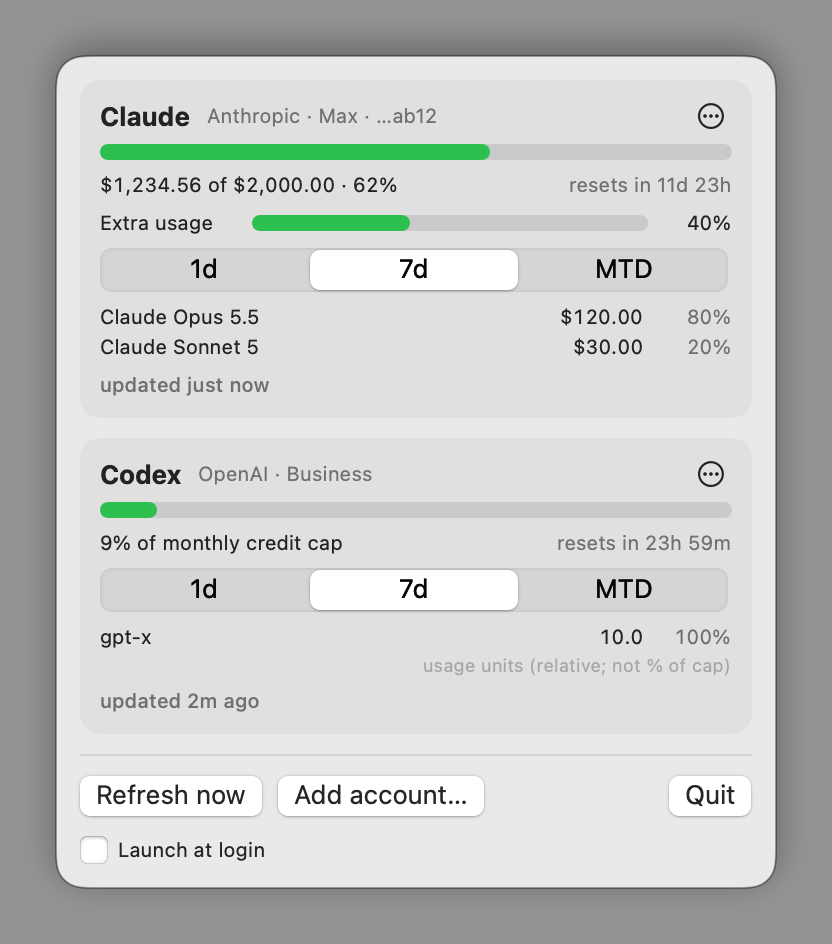
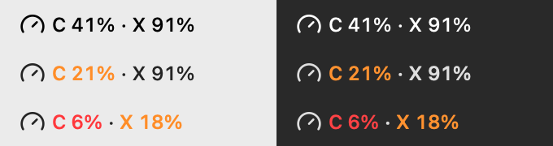

# TokenMeter

A macOS menu-bar app that shows your Claude and Codex usage caps, with per-model usage, for one or more accounts.

- Claude: monthly spend cap, extra-usage (hidden when it only repeats the cap) and 5-hour / 7-day bars, plus per-model spend (1d, 7d, month-to-date).
- Codex: monthly credit cap and per-model usage.
- Menu-bar label: remaining % for the (up to) two most-constrained accounts. `C` is Claude, `X` is Codex; amber under 25% remaining, red under 10%.

## Install

    curl -fsSL https://raw.githubusercontent.com/roy-diptanil/TokenMeter/main/install.sh | bash

What the script does (it is short, read it first if you like):

- Builds TokenMeter from source on your Mac (checkout in `~/.tokenmeter-src`) and installs it to `/Applications`.
- Never touches your sign-ins or data in `~/Library`.
- Safe to re-run to update.
- If `/Applications` isn't writable (and `sudo` can't prompt), it installs to `~/Applications` instead and says so.

Then click the gauge icon in the menu bar and choose "Add account...".

Requires macOS 14+ and the Xcode Command Line Tools (the script starts their install if missing, then asks you to re-run it). No other dependencies.

To uninstall (keeps your data; add `--purge-data` to delete it too):

    ~/.tokenmeter-src/uninstall.sh
    # or
    curl -fsSL https://raw.githubusercontent.com/roy-diptanil/TokenMeter/main/uninstall.sh | bash

If you enabled "Launch at login", you may also need to remove TokenMeter from System Settings > General > Login Items.

### Updating

Click "Check for updates" in the popover footer. TokenMeter compares the commit it was built from (shown as "Version abc1234")
with `main` on GitHub using `git ls-remote`, at most once a day on its own and silently. TokenMeter checks for updates about once a day in the background. If a newer commit exists, "Update now"
runs the same install command as above in the background, then restarts the app after the build. Progress goes to
`~/Library/Logs/TokenMeter-update.log`; if the app is still running after about five minutes, the footer says so and offers "Open log".
A failed build leaves the old app in place. Builds from a local checkout with changes show as "Dev build" and never prompt.

### Development

    ./build.sh                                          # builds build/TokenMeter.app (ad-hoc signed)
    swift run SelfTest                                  # parser/logic tests (synthetic fixtures only)
    build/TokenMeter.app/Contents/MacOS/TokenMeter --dump   # one-shot fetch, prints numbers only

Needs a Swift 6 toolchain.

## Sign-in and data (local only)

You sign in to claude.ai or chatgpt.com in a window inside the app ("Add account..." or "Sign in..."). The app reads usage by
making requests from inside that web session, so it never sees or stores your password, tokens or cookies.

- Browser sessions live in a per-account WebKit data store on your Mac (`~/Library/WebKit/com.local.tokenmeter/`).
  Removing an account deletes its store.
- `~/Library/Application Support/TokenMeter/accounts.json`: account labels and store IDs.
- `~/Library/Application Support/TokenMeter/cache.json` (mode 0600): last usage numbers, the last 4 characters of an account id and a short hash used to detect duplicate accounts. No tokens.
- The only network traffic is to claude.ai and chatgpt.com from the sign-in web view. No telemetry, no server, nothing hosted.
- Credentials are never logged and never written to disk by the app. The CLI and Keychain are not used.

Saved passwords from Safari or the Passwords app do not autofill in an embedded web view; paste from your password manager (Cmd+V works) or use the email one-time code. Sessions expire on the providers' schedule; an expired account shows a "Sign in" button.

## Account status

Each account card has a status dot, with two states:

- Green: the most recent refresh succeeded.
- Red: the most recent refresh failed for any reason (signed out, network error, endpoint changed, timeout, or per-model data unavailable), or the account was never signed in. The card keeps the last good numbers (dimmed) and shows the reason with "last synced ...". Auth problems get a "Sign in" button; anything else gets "Retry". Hover the dot for details.

Use ⋯ → Show in menu bar to pick up to 3 accounts for the menu-bar label; by default it shows the two closest to their cap.

When any account is red, a summary row appears at the top of the popover and the menu-bar label gets a red `!` after the percentages.
Besides the 5-minute timer, TokenMeter refreshes when the Mac wakes, when the network comes back, and when you open the popover after a minute. None of these ever opens a sign-in window.
"Refresh now" shows a one-line result for a few seconds. `--dump` prints a `health:` line per account.

## Layout

- `Sources/UsageCore`: models, parsers, web session, store, menu-bar label logic
- `Sources/TokenMeter`: SwiftUI views and app entry, plus the `--dump`, `--probe-*` and `--selftest-ui` debug flags
- `Sources/SelfTest`: tests

Gauge icon from Lucide (ISC), see `THIRD_PARTY_NOTICES.md`.

## License and disclaimer

TokenMeter is free, open-source software released under the [MIT License](LICENSE). You may use, copy, modify and
redistribute it. It is provided "as is", with no warranty of any kind, and the author accepts no responsibility or
liability for anything that results from using it.

- **Unofficial.** TokenMeter is an independent project. It is not affiliated with, endorsed by, or supported by Anthropic or OpenAI.
  "Claude" and "Codex" are used only to describe what the app reads.
- **Undocumented endpoints.** It reads usage from web endpoints that are not public APIs. They can change or stop working at any
  time, and the numbers shown may be wrong or out of date. Do not rely on them for billing or budgeting.
- **Your accounts, your responsibility.** The app signs in through a web session you create, the same way a browser does.
  Check that automated or scripted use of your account is allowed by the terms of the service and by your employer's policies.
  You are solely responsible for how you use it.
